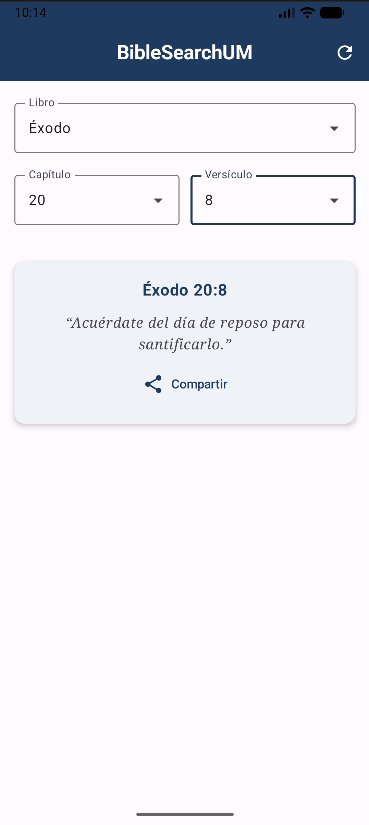

# Biblia RV1960 — App de consulta bíblica con React Native

Aplicación móvil multiplataforma (iOS y Android) construida con **React Native + Expo** que consume la API REST pública de [bolls.life](https://bolls.life) para consultar la Biblia en la traducción **Reina-Valera 1960 (RV1960)**.

Proyecto del *Laboratorio guiado* de la materia **Tecnologías de desarrollo de software** — tema: *Desarrollo de aplicaciones móviles no nativas con React Native*.

## Vista previa

<p align="center">
  
</p>

<p align="center"><em>Versión final de la app: consulta de <strong>Éxodo 20:8</strong> en RV1960.</em></p>

---

## Características

- **Dos modos de consulta** seleccionables con botones en la parte superior:
  - **Capítulo completo:** se elige libro y capítulo, y se muestran todos los versículos en una lista desplazable (`FlatList`).
  - **Versículo único:** se elige libro, capítulo y versículo, y se muestra solo ese texto en una tarjeta.
- **Lista real de los 66 libros** cargada desde la API al abrir la app (de Génesis a Apocalipsis).
- **Formulario controlado con validación** antes de consultar:
  - Libro obligatorio.
  - Capítulo entero, mayor a 0 y no mayor al número de capítulos del libro (p. ej. *"Juan tiene 21 capítulos."*).
  - Versículo entero mayor a 0 (solo en modo versículo).
- **Indicadores de carga** (`ActivityIndicator`) mientras se cargan los libros y mientras llega cada respuesta; el botón cambia a *"Consultando…"* y se deshabilita.
- **Manejo de errores** sin que la app se cierre: sin conexión (modo avión), capítulo inexistente (respuesta vacía) o versículo inexistente (HTTP 404).
- **Limpieza del texto** recibido: se eliminan etiquetas HTML como `<br>` y los espacios duplicados.
- **Reinicio del formulario** al cambiar de modo (los resultados anteriores se borran).
- Código **100 % JavaScript** (sin TypeScript); componentes de interfaz en archivos `.jsx`.

## Tecnologías

| Tecnología | Versión | Uso |
|---|---|---|
| Expo SDK | ~58 | Plataforma de desarrollo y ejecución (Expo Go) |
| React Native | 0.88 | Componentes móviles nativos |
| React | 19 | Estado (`useState`) y efectos (`useEffect`) |
| expo-status-bar | ~58 | Barra de estado |
| `fetch` + `async/await` | nativo | Consumo de la API REST |
| API bolls.life | — | Fuente de datos (RV1960) |

## Estructura del proyecto

```
biblia-app/
├── App.js                         Pantalla principal (punto de entrada)
├── index.js                       Registro del componente raíz (generado por Expo)
├── app.json                       Configuración de Expo (nombre, íconos)
├── package.json                   Dependencias y scripts
├── assets/                        Íconos e imágenes
├── images/                        Capturas de pantalla para el README
└── src/
    ├── api/
    │   └── biblia.js              Llamadas a la API con fetch
    ├── components/
    │   ├── FormularioConsulta.jsx Formulario: libro, capítulo y versículo + validación
    │   ├── SelectorLibro.jsx      Lista desplegable de libros
    │   ├── ListaVersiculos.jsx    FlatList con el capítulo completo
    │   └── TarjetaVersiculo.jsx   Tarjeta con un solo versículo
    ├── data/
    │   └── ejemplo.js             Datos de prueba (usados antes de conectar la API)
    └── utils/
        └── texto.js               Limpieza del texto de la API
```

## Módulos y funciones

### `App.js` — Pantalla principal
Orquesta toda la app. Mantiene el estado global de la pantalla:

| Estado | Descripción |
|---|---|
| `modo` | `'capitulo'` o `'versiculo'` |
| `libros`, `cargandoLibros`, `errorLibros` | Lista de libros y el estado de su petición |
| `cargando`, `error` | Estado de la consulta en curso |
| `titulo`, `versiculos`, `textoVersiculo` | Resultado a mostrar |

Funciones:
- `useEffect(..., [])` → `cargarLibros()`: pide los 66 libros una sola vez al abrir la app.
- `cambiarModo(nuevoModo)`: cambia de modo y limpia resultados.
- `limpiarResultados()`: borra error, título y resultados.
- `consultar({ libro, capitulo, versiculo })`: llama a la API según el modo, valida la respuesta y muestra el resultado o el mensaje de error (`try / catch / finally`).

### `src/api/biblia.js` — Módulo de la API
| Función | Endpoint | Devuelve |
|---|---|---|
| `pedirJSON(ruta)` *(interna)* | — | JSON; lanza error si `respuesta.ok` es falso |
| `obtenerLibros()` | `GET /get-books/RV1960/` | `[{ bookid, chronorder, name, chapters }]` (66) |
| `obtenerCapitulo(libroId, capitulo)` | `GET /get-text/RV1960/{libro}/{cap}/` | `[{ pk, verse, text }]` |
| `obtenerVersiculo(libroId, capitulo, versiculo)` | `GET /get-verse/RV1960/{libro}/{cap}/{ver}/` | `{ pk, verse, text }` |

### `src/components/FormularioConsulta.jsx`
Formulario controlado con estados `libro`, `capitulo`, `versiculo` y `errorForm`.
- `validar()`: devuelve el mensaje de error o `''` si todo es válido.
- `enviar()`: valida y, si es correcto, llama a `onConsultar` del padre.
- Props: `modo`, `libros`, `cargando`, `onConsultar`.

### `src/components/SelectorLibro.jsx`
Lista desplegable hecha con `Pressable` + `ScrollView` (altura máx. 200). Estado interno `abierto`.
- Props: `libros`, `seleccionado`, `onSeleccionar`.

### `src/components/ListaVersiculos.jsx`
Muestra el capítulo con `FlatList` (`keyExtractor` usa `pk`); cada texto pasa por `limpiarTexto`.
- Props: `titulo`, `versiculos`.

### `src/components/TarjetaVersiculo.jsx`
Componente de presentación (sin estado) para un versículo.
- Props: `referencia` (p. ej. `"Juan 3:16"`), `texto`.

### `src/utils/texto.js`
- `limpiarTexto(texto)`: reemplaza `<br>` por espacio, quita otras etiquetas HTML y colapsa espacios repetidos.

### `src/data/ejemplo.js`
- `LIBROS_EJEMPLO` y `VERSICULOS_EJEMPLO`: datos falsos con la misma forma que la API, usados en el día 2 para construir la interfaz sin internet. Ya no se usan en la versión final.

## Flujo de la aplicación

1. Al abrir: se muestra un indicador de carga y se piden los libros a la API.
2. El usuario elige el modo (Capítulo completo / Versículo único).
3. Llena el formulario; si hay datos inválidos aparece un mensaje en rojo.
4. Al presionar **Consultar** se hace la petición y aparece un indicador de carga.
5. Se muestra la lista de versículos o la tarjeta del versículo, o un mensaje de error.

## Ejecución rápida

```bash
npm install
npx expo start      # o: npx expo start --tunnel
```
Escanea el QR con la cámara del iPhone (se abre en Expo Go).
Instrucciones detalladas en **`INSTRUCCIONES_EJECUCION.txt`**.
